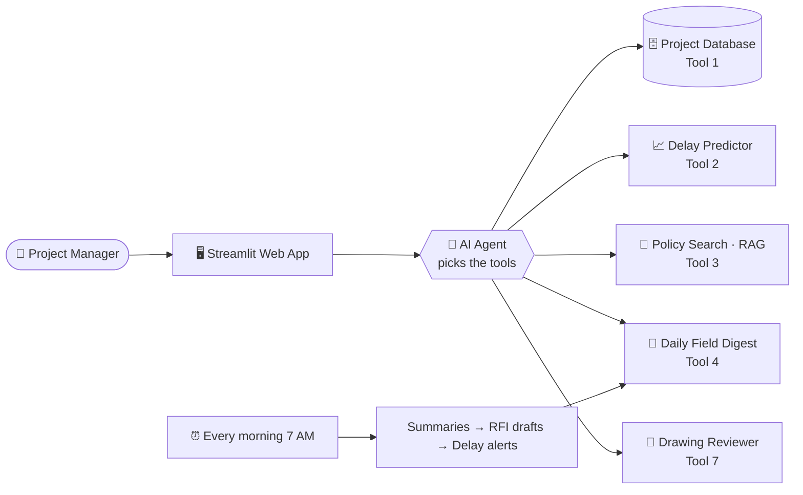
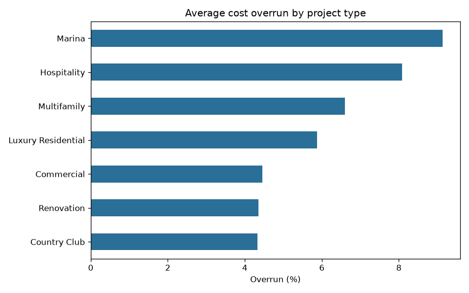
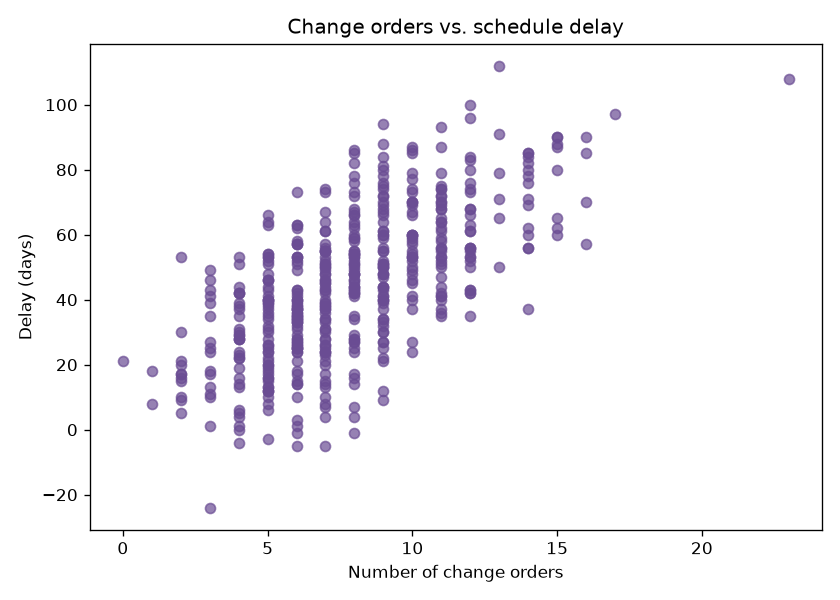

<div align="center">

# 🏗️ Construction AI Assistant

### An AI operations toolkit for a South Florida construction company

*From messy field notes to pre-construction drawing reviews: 7 AI tools, one agent, all measured.*

[](https://constructionaiassistant-pjrf4zs8murqnpvmufgiwj.streamlit.app)


</div>

---

## 📊 At a glance

<table>
<tr>
<td align="center"><h2>7</h2>AI tools</td>
<td align="center"><h2>½</h2>delay prediction error<br>vs. baseline</td>
<td align="center"><h2>96.7%</h2>RAG accuracy<br>0 hallucinations</td>
<td align="center"><h2>12/12</h2>agent eval<br>tests passing</td>
<td align="center"><h2>15/15</h2>drawing problems<br>caught</td>
</tr>
</table>

> **The problem:** construction teams lose hours every day digging through contracts, reading messy field notes,
> chasing RFIs, and catching drawing problems too late. **This project automates the first pass**, and always
> leaves the final call to a human.

*Built on synthetic data for a fictional contractor, "Coastline Builders" (real company data is private).*

---

## 🧭 How it fits together



---

## 🧰 The 7 tools

| | Tool | What it does | Headline result |
|---|---|---|---|
| 🗄️ | **1. Data migration** | Cleans a messy export, migrates it to SQL, verifies it | 508 → 500 clean records |
| 📈 | **2. Delay predictor** | Charts + ML model predicting schedule delay | Error cut from 17.7 → **8.9 days** |
| 📄 | **3. Policy Q&A (RAG)** | Answers from company documents, with sources | **96.7%**, refuses to guess |
| 📝 | **4. Automations** | Field-log digest, RFI drafts, delay alerts, daily schedule | Runs 3/3 steps unattended |
| 🧪 | **5. Post-training** | LoRA fine-tuning vs. RAG, scored by an LLM judge | RAG beat fine-tuning **96.7% vs 26.7%** |
| 🤖 | **6. AI agent** | Chooses and chains tools, with guardrails and tracing | **12/12** eval tests |
| 📐 | **7. Drawing reviewer** | Reviews drawing PDFs for pre-construction issues | **15/15** planted problems caught |

---

## 🗄️ Tool 1: Data Migration Pipeline

Real exports are messy. This pipeline cleans one and migrates it into a database:

- 🧹 Removes duplicates and standardizes names (`broward`, `BROWARD`, ` Broward ` → `Broward`)
- 🚩 **Flags** missing costs for human review instead of guessing
- ➕ Adds delay and cost-overrun metrics
- ✅ Verifies the migration with SQL queries

## 📈 Tool 2: Project Insights + Delay Predictor

> 💡 **Key finding:** change orders are the strongest driver of delay (correlation **0.65**).
> Marina projects run the most over budget (**9.1%**) and late (**66 days**).

<p align="center">
  
  
</p>

| Model | Avg. error (MAE) | R² |
|---|---|---|
| Baseline (always guess the average) | 17.7 days | -0.06 |
| **Linear Regression ✅ selected** | **8.9 days** | **0.70** |
| Random Forest | 11.3 days | 0.57 |

*The simpler model won: these delays follow a mostly linear pattern. Fancier isn't always better.*

## 📄 Tool 3: Policy Q&A (RAG)

Ask a question → find the right document sections by **meaning** (embeddings) → answer **only** from them, with citations.

| Question | Answer | Match |
|---|---|---|
| Weather delay notice deadline? | ✅ 7 calendar days | 0.83 |
| Documents for final payment? | ✅ Lien waivers, as-builts, O&M manuals, warranties | 0.77 |
| Remote work policy? | 🛑 *"I couldn't find that in the company documents"* | 0.58 |

That last row matters most: **it refuses instead of inventing an answer.**

## 📝 Tool 4: Workflow Automations

Every morning at 7 AM, with no one pressing a button:

```
📋 Messy superintendent field logs
   └─▶ 📝 Structured digest, sorted by priority (safety, RFIs, change orders, late materials)
        └─▶ ❓ Formal RFI drafts following company rules (marked DRAFT for PM review)
             └─▶ ⚠️ Delay-risk email alerts for at-risk projects (dry-run by default)
```

Each step is isolated (one failure doesn't stop the others) and every run is logged.

## 🧪 Tool 5: Post-Training Experiment

**Question:** to teach an AI company policy, is it better to **fine-tune** a model or use **RAG**?

102 synthetic Q&A pairs → **LoRA fine-tuning** of Qwen3-0.6B on a free Colab GPU (0.76% of parameters trained,
loss 2.24 → 0.45 in 61 seconds) → graded by an LLM judge on 15 unseen questions:

| System | Score | Hallucinations |
|---|---|---|
| Base model | 50.0% | 8 |
| Fine-tuned (LoRA) | 26.7% 📉 | 12 |
| **RAG** | **96.7%** 🏆 | **0** |

> 💡 **Finding:** fine-tuning taught the model the company's *tone*, not its *facts*, and made it more
> confidently wrong (e.g. "fall protection at 5 feet" instead of 6). **Use RAG for facts; save fine-tuning for style and format.**

## 🤖 Tool 6: AI Agent

Ask in plain English. The agent decides which tools to use, in what order:

> **You:** *Which active marina project is most at risk, and how many days do we have to file a weather delay notice?*
>
> 🔧 `rank_active_projects_by_risk` → 🔧 `search_company_docs`
>
> **Agent:** *Harbor Point Marina Expansion (A2001), predicted ~92 days late (±9). Weather delay notices are due
> within **7 calendar days** [Contract General Conditions, Schedule and Delays].*

**🛡️ Guardrails:** read-only SQL (two layers), max 8 steps, no invented facts, strict safety rules,
no quantity takeoffs, file access locked to the drawings folder · **🧠 Memory:** last 3 exchanges ·
**🔍 Tracing:** every decision logged

<details>
<summary><b>🐛 What the evaluation suite caught and fixed (click to expand)</b></summary>

| Problem found | Fix |
|---|---|
| Checked only 5 of 8 projects; right answer by luck | New ranking tool: 6 steps → 1 |
| Invented explanations ("due to permitting") | Tightened system prompt |
| 2 correct answers marked wrong (rounding, invisible space) | Fixed the checker, not the agent |
| Blended project names from two systems | Aligned IDs across systems + regression test |
| Case-sensitive SQL (`'marina'`) → "no marina projects" | Exact values in tool schema + retry rule (found via trace logs) |
| Flaky test (65.5 vs 66) | Checker accepts any valid answer |

**Lesson:** always ask *"is the model wrong, or is the test wrong?"* before changing anything.
</details>

## 📐 Tool 7: Pre-Construction Drawing Reviewer

Upload an architectural drawing set (PDF) → get a first-pass pre-construction report.

**Hybrid design: the AI _reads_, the code _judges_.**

| Step | Who | What |
|---|---|---|
| 1 | 👁️ Gemini (multimodal) | Extracts sheet index, door/window schedules, notes. No guessing, no measuring |
| 2 | 🐍 Python rules | Missing sheets · missing Miami-Dade NOAs (hurricane zone) · long-lead items · vague notes → RFIs |
| 3 | 👷 Human | Reviews the DRAFT report |

**🚫 Deliberately not automated:** quantity takeoffs, measurements, clash detection. AI is unreliable there,
and mistakes cost real money.

**Tested** on a sample set with 15 planted problems: **15/15 caught**, one boilerplate false alarm found and filtered.
*Caveat: real scanned drawings will be harder than this clean sample.*

---

## 🧠 Five models, each chosen for a reason

| Model | Job | Why this one |
|---|---|---|
| ⚡ Groq `gpt-oss-120b` | Agent, drafting, summaries, LLM judge | ~1 second responses, strong tool calling |
| 👁️ Gemini Flash | Reading drawing PDFs | Multimodal: can "see" documents |
| 🔎 Gemini Embedding | RAG search | Matches by meaning, not keywords |
| 🧪 Qwen3-0.6B + LoRA | Fine-tuning experiment | Small enough to train free |
| 📏 Linear Regression | Delay prediction | Predicting a number doesn't need an LLM |

## 🛡️ Built like production software

✅ Switch AI providers with one setting · ✅ Retries with exponential backoff · ✅ Timeouts ·
✅ Secrets never committed · ✅ Friendly errors for users, full logs for maintainers ·
✅ Human review on every AI draft · ✅ Automated evaluations with score history

---

## 🚀 Run it yourself

```bash
python -m venv .venv
.venv\Scripts\Activate.ps1           # Windows  (Mac/Linux: source .venv/bin/activate)
pip install -r requirements.txt
# add a .env file with GEMINI_API_KEY, GROQ_API_KEY, LLM_PROVIDER and model names

streamlit run src/app.py             # 🖥️ the web app
```

<details>
<summary><b>All commands (click to expand)</b></summary>

```bash
python src/generate_data.py          # create realistic sample data
python src/clean_data.py             # clean it
python src/migrate_to_db.py          # migrate into SQLite
python src/make_charts.py            # charts + statistics
python src/train_delay_model.py      # train the delay predictor
python src/build_index.py            # build the document search index
python src/daily_run.py              # run all daily automations
python src/make_sample_drawings.py   # create the sample drawing set
python src/review_drawings.py        # review it (prints an answer-key score)
python src/agent.py                  # chat with the agent in the terminal
python src/eval_agent.py             # run the agent evaluation suite
python src/evaluate_models.py        # fine-tuning vs. RAG scoreboard
```
</details>

<details>
<summary><b>Project structure (click to expand)</b></summary>

```
├── data/          project data, database, field logs, drawings, fine-tuning data
├── docs/          company documents (contract, safety, closeout, RFI process)
├── charts/        insight charts
├── models/        trained delay model
├── notebooks/     Colab notebook for LoRA fine-tuning
├── outputs/       digests, RFI drafts, alerts, scoreboards, eval reports, drawing reviews
├── src/           all code (one file per step, grouped by tool)
├── run_daily.bat  launcher for Windows Task Scheduler
└── requirements.txt
```
</details>

---

<div align="center">

**🛠️ Tech:** Python · pandas · NumPy · SQL · Matplotlib · scikit-learn · Gemini · Groq · Embeddings · RAG ·
Streamlit · Hugging Face · Transformers · PyTorch · LoRA · TRL · LLM-as-a-judge · Tool calling · AI agents ·
Guardrails · Tracing · Multimodal AI

*Built with AI-assisted coding. I designed the tools, tested and debugged every component,
wrote the evaluations, and can explain each design decision.*

</div>